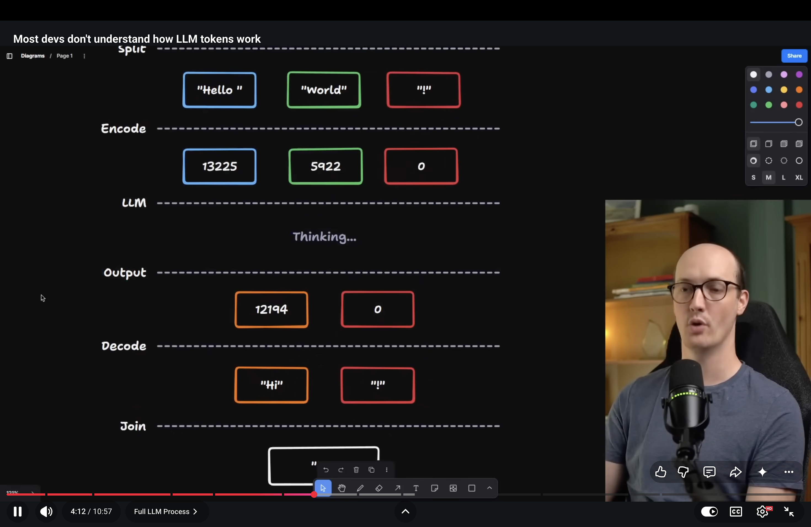

# What is tokenization?
- Tokenization is the process of breaking the text sentence in to multiple small units tokens. So that llm can process them.
- Tokenization is the process of breaking input text into smaller units called tokens. These tokens are then encoded into numerical IDs so that the neural network can process their numerical representations.
- I
- love
- building
- AI
- applications
- .

- The sentence contains six tokens in this example, not necessarily six words.

# Why do we need tokenization?
- Because LLM neural network perform numerical operations on the numerical representations.
- The computer don't understand human langauge that's why we need to convert the token into token IDs.
- Just compiler converts the code in to binary.
- Similarly, LLMs convert text into numerical representations before processing it.

- The process looks like this:
1. Human text. "I love AI"
2. Tokenizer : Breaks the text in to smaller units tokens.
3. Encoding: Each token is assigned token id. Tokenizer have the token vocabulary.
4. Embedding: Numerical vectors representing tokens
5. Transformer: Processes the representations

# What are token IDs?
- Every token in tokenizer vocabulary have the numerical token id assigned to each token.
- When you provide:
I love AI

- The tokenizer might convert it into:
[40, 982, 1256]

# What is a tokenizer?
- A tokenizer is the component responsible for converting text into tokens and token ID and converts token IDs back into text.
1. Tokenization: Break text into smaller pieces called tokens.
2. Encoding: Map those tokens to their numerical IDs.
- There are two important operations:
- Operation	Meaning
- Encoding	Text → Token IDs
- Decoding	Token IDs → Text

# What happens if a word isn't in the vocabulary?
- This is where subword tokenization becomes useful.
- Suppose unbelievable isn't available as one complete token.
- Uncommon words are not directly in tokenizer vocabulary.

- The tokenizer might split it: Subword tokens.
unbelievable
     |
     v
["un", "believ", "able"]
     |
     v
[205, 310, 415]

# Why should AI engineers care about tokens?
1. API Pricing -> LLM API providers charge on tokens. Input tokens and outpust tokens.

2. Context window: An LLM have the limited amount of context it can process in a request. This limit is measured in tokens.

3. Response speed: Generating more tokens generally takes more time because autoregressive models generate output sequentially.

4. Language differences: The same meaning expressed in different languages can consume different numbers of tokens.

##########################

1. What is tokenization?
Tokenization is the process of breaking input text into smaller units called tokens so that an LLM can process them.

2. What is a token ID?
A token ID is a numerical identifier assigned to a token in a tokenizer's vocabulary.

3. What is a tokenizer?
A tokenizer converts text into tokens and token IDs (encoding) and converts token IDs back into text (decoding).

4. Why do LLMs use tokens?
Neural networks operate on numerical representations, so text must be converted into numerical forms before the model processes it.

