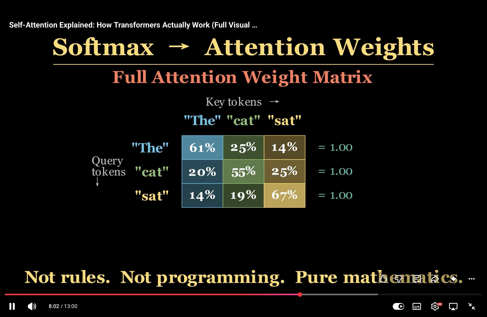
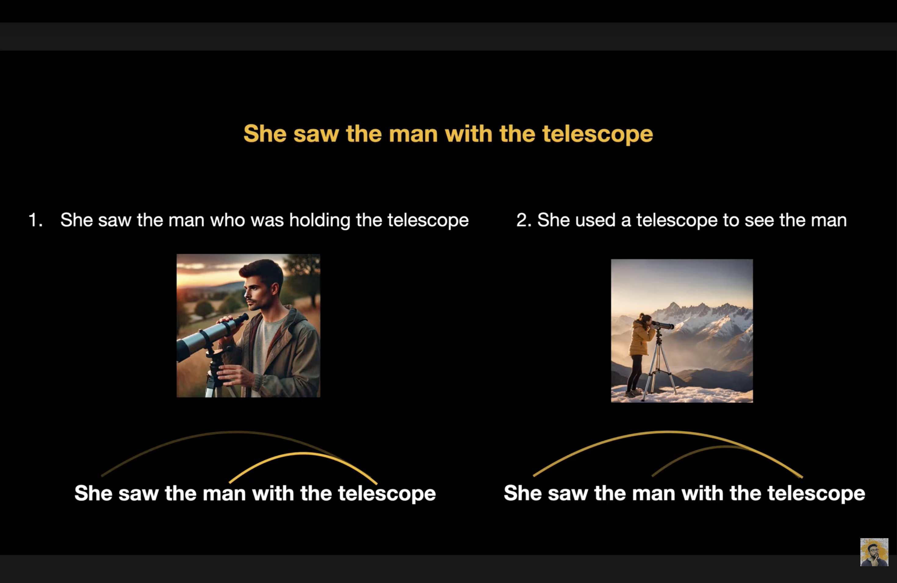
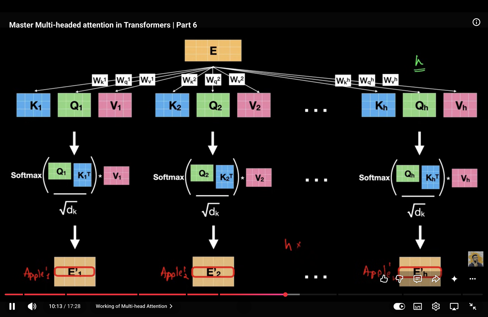
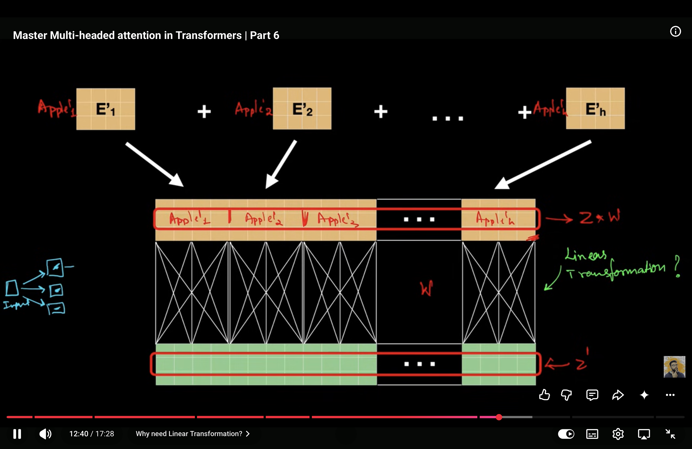

# Attention Mechanism:
1. As we know user prompt is tokenized in to smaller units called token and than token id is assigned to each token using tokenizer vocabulory. And then embedding takes place in embedding each token is converted in to vectors which is the ordered list of numerical values. The llm converts each token in to embedding using embedding lookup table,

2. The embeding transform the token or other piece of information into high dimensional vectors. with 1000s of dimensions in actual llm like chatgpt.
3. These vectors are called embeddings. They represent tokens numerically and can capture useful relationships between concepts. For example, the embeddings of cat and dog may have similar semantic properties.
4. For example embedding of cat is closer or similar to the ebmbdding of dog and rat becausee there difference in vectors is very low because they are all animals.

5. The issue with static embediing is that they have actual representation of token but not the contextual.
- Means I got money from Bank. And Ram is sitting on river bank.
- Here both bank are different.
- But Embedding have the same vector for both Bank which is problem.   Because it doesn't take context in the account.

- Same goes with Apple fruit and Apple company. embedding assigns the same vectors to both the apple.
- Ideally we want embedding of apple to adapt based on its meaning and context.
- So the solution for these static embedding is to change the embedding according to the context.
- That's why we need Attention.

# The solution: Contextual representations
- Modern Transformers use Attention to allow tokens to gather relevant information from other tokens in the sentence.

- This helps the model build context-aware representations of tokens.
- For example, the representation of bank can become different depending on whether the sentence discusses money or a river.

# Basic Flow.
1. Input text
- "I deposited money in the bank."

2. Tokenization
Text → Token IDs

3. Embedding lookup
Token IDs → Initial vectors

4. Attention
Tokens gather relevant contextual information

5. Context-aware representations: After getting the context for each token it is turn in to context aware representation

# Attenction
- The embedding represents learned information about the token, but it hasn't yet incorporated all the information from the current sentence.
- The model needs a mechanism to let tokens exchange information with other tokens.

- Definition: Attention is a mechanism that calculates how much information from other tokens should contribute to the representation of a particular token.
- Token looks at other relevant tokens in the context to build a better representation of what it means.

# QUERY, KEY AND VALUE.
- User prompts The bank approved my loan because it trusted my income.
- Here Text is tokenized and static embedding is aasigend to each token.
- Here it have static emebdding vector which is the actual representation but does not acount for context.
- How does LLM knows that here it refers to Bank. With static embedding it does not account for context and it just represent the actual repsentaation of token.

- We want llm model to understand what it refers to.
- For that token it needs information other tokens in the sentence.
- This is where Q,K and V comes in.

1. Query: 
- Q = What information i am looking for?
- The query represents what a token is looking for from other tokens.
- Imagine the token it is asking:
- Which word in this sentence can help me understand what I refer to?

2. Key:
- Key means what information other tokens offer for matching.
- The model compares the Query of it with the Keys of other tokens.

- Think of it like this:
- Q asks a question.
- K helps determine whether a token is relevant to that question.

- Q meets K
- Q of it → "What am I referring to?"

- Compare against K of bank, loan, income, etc.
- Calculate attention scores

3. Value:
- What actual information each token contribute?
- "What information should I contribute if another token finds me relevant?"
- Imagine the model determines that bank is highly relevant to it.

- The model then uses the Value vector of bank to obtain information from that token.

- Query and Key help calculate relevance.
- Value carries the information that gets combined.

# Attention workflow
1. Token: it
   Query (Q)
   "What am I referring to?"

2. Compare Q with all Keys (K)
   Calculate relevance scores

3. Illustrative attention weights
bank 0.70

loan 0.20

income 0.10

4. Use the Values (V)
Combine information from tokens according to their attention weights.

5. New contextual representation for it.

# The actual Attention workflow
- Let's connect Q, K and V.
- Suppose we have three tokens:
- Developer, built, application

- Each token gets its own Q, K and V vectors.
- Each token produces three vectors
1. Q : Query
2. K: Key
3. V: Value

- Each token has its own three learned projections.

1. Step 1: Compare Query with Keys
The model compares a token's Query with the Keys of available tokens.

2. Step 2: Calculate attention scores
Higher scores indicate stronger matching according to the learned attention mechanism.

3. Step 3: Apply Softmax
Converts the scores into normalized attention weights.

4. Step 4: Combine Values
The model multiplies each Value by its attention weight and combines them.

5. Result: Updated token representation
The token now has information gathered from other relevant tokens.

# SELF ATTENTION
- Self Attention is the mechanism in which each token learn and looks to other tokens in the same sequence to understand its context.
- Input sentence
- "The cat drank milk because it was thirsty."

- Now here how does model learns what it refers to?
- In self attention LLM use Query, Key and value vectors to repsent the each token contextually.

1. First each token is converted in to static emedding.
2. Each token have the Q, K and V vectors.
3. Query compare with each key to create attnection score. Query means what each token is looking for. And Key means what information each token can offer for matching.
4. Than useing soft max, attention score is converted in to attention weight.
5. Than model multples each token value with attnetion weight and combine them to create the context aware representation of token.

- Self-Attention is a mechanism in which each token compares its Query with the Keys of other tokens in the same sequence and uses the resulting attention weights to combine their Value vectors, producing contextual representations.

# MULTI HEAD ATTENTION
- The problem with self attention is that it only accounts for single attention pattern or persepective.
- But in real language is much more complex.Tokens can have multiple relationships with other tokens, such as semantic, grammatical and contextual relationships.
- That's why we need Multi head attention. 

- Multi-Head Attention allows an LLM to learn multiple attention patterns in parallel using multiple independent attention heads.
- Each attention head has its own learnable Q, K and V projection matrices.
- The outputs of all attention heads are concatenated and passed through a final linear projection to produce the Multi-Head Attention output.

1. For example "She saw the man with th telescope."
- It have 2 seprate meaning on the basis of prespective. And multiple head attention let LLM to learn these multiple attenion pattern using the multiple independent attention heads.
.

2. Single head of attention just focus on single attention pattern or realtionship in the sentence. Like spatial relatinship.

3. Each head of attention has it's own Query, Key and Value matrices.
- Each token Query compares with other key of tokens to create attention score.
- Than using softmax attention score is converted in to attention weight.
- Each token value is multiplied with its attention weight and combine to create the context aware respesentation of the token.

4. There will be h number of context aware repsentation for each token in that sentence.
- H is number of heads of attention.
- 
- Each of this output will be capturing differnt expect of that sentnece.

5. And new conrext aware repsentation of each token will be the concatination of multiple ooutputs of all the attenion head.

6. Than that concatincation is passed though linear projection to produce the multi head attention output.
- 

