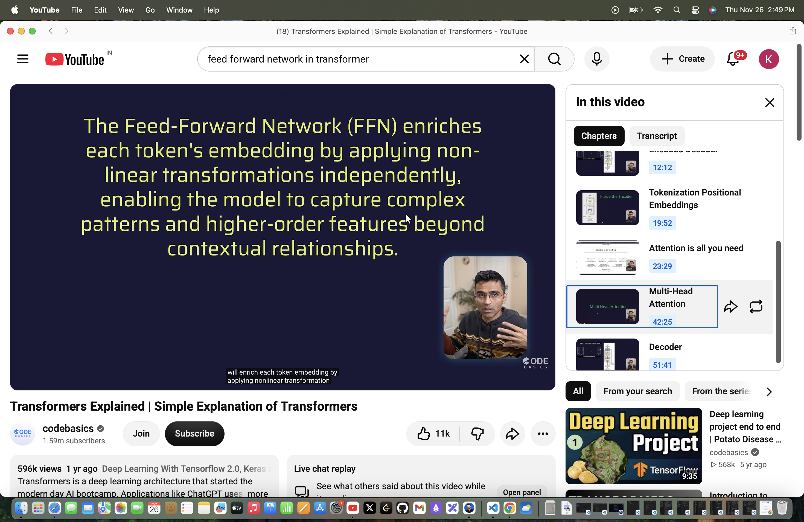
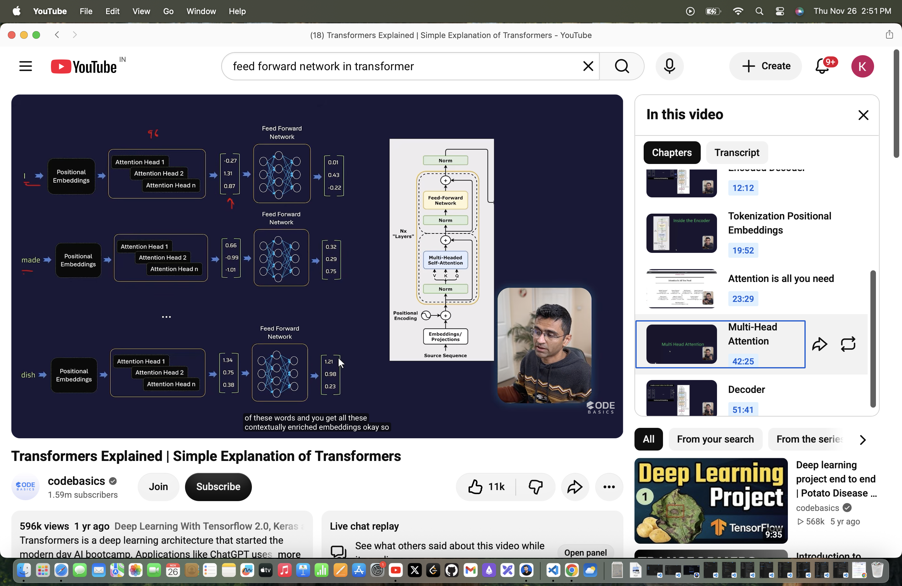
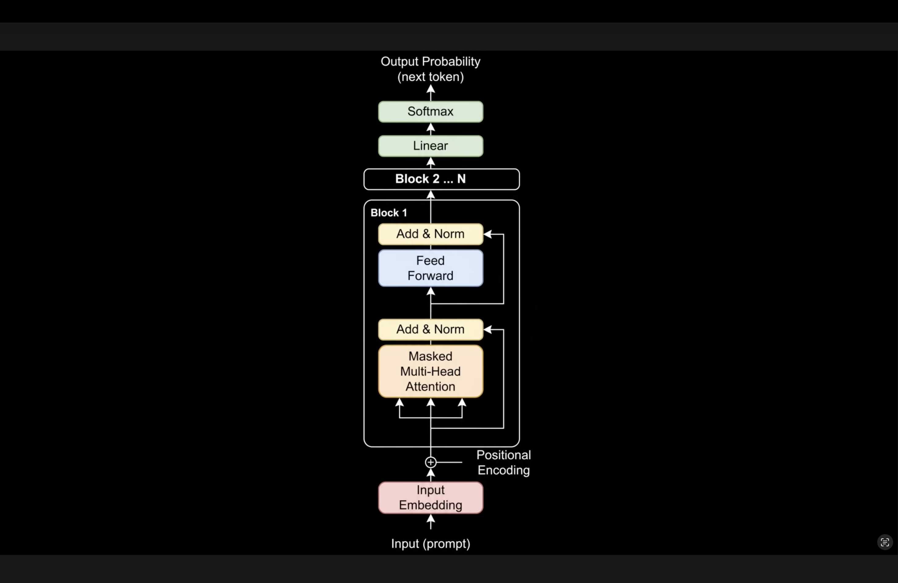
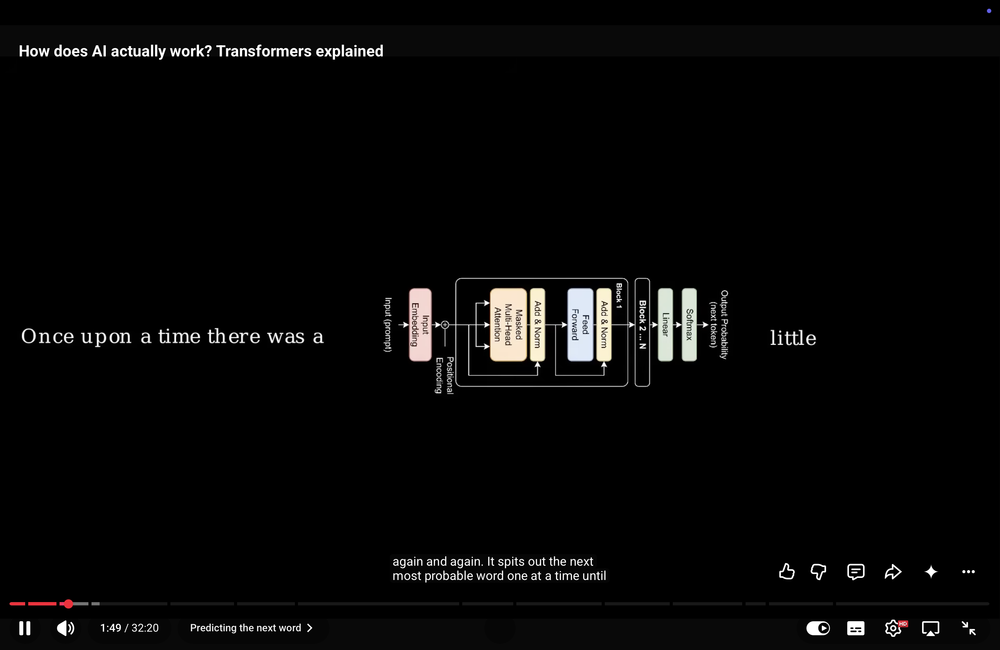

# What is GPT?
- GPT stands for Generative Pre-trained Transformer.
1. Generative means it generate the next or new sequence/token.

2. Pre-trained means the model is trained on large amount of data before user use it. 
- In pretraining model learns the patterns in language, code or information and it learn relationship by predicting the next token.

3. Transformer is the neural architecture which allows the LLM to analyse the text, understand the context for each token and predict the next token.

# TRANSFORMER
- Transformer is the neural netwrok architecture which allows the LLM to understand the realtionship between multiple tokens and build the context for each tokens and process the tokens to predict the next token again and again until whole resp is generated.

# User writes the prompt.
# Step-1 Encdoing
1. Step-A Tokenization.
- The LLM breaks the text in to multiple smaller units called tokens.
- And assigns the token id to each token using tokenizaer voabulory.
- The uncommon tokens are tokeinzed funrther and token id is assigned to each sub token.
- In tokenization model breaks the text into smaller units called token and assigns the token id to each token.

2. Step-B Embedding.
- The model than converts each token id in to embedding vector which is the ordered list of numerical values.
- The model assings the vector to each token by using the embdding lookout table.
- The embedding repsents the actual infomration about the token.
- The embedding allows the LLm to understand the semantic relaitonship between the tokens.
- An embedding is a learned numerical representation of a token. It captures patterns and relationships learned during training,

- It is the step 1 converting user prompt in to token and than emmedding.

# Step-2 Posititional Encoding.
- As we know the embedding repsents the actual information about the token. But LLM needs the information about the position of token as well. Cause Traansformer reads each token simaltaneously unlike human who readsentence left to write.
- So, now the token dog positioned at first place will be same as the token Dog position at the end.
- The sentences, The dog but the cat AND The cat bit the dog and have same inital embeddings. And look identical to transfomer.
- The positional encoding is the technique that provides the information about the position of the token in the sequence.
- It creeates the position aware representation of the token.
- It combines token learned information with positional information to create position-aware token representations.
- X = E + P 

# Important distinction: Tokenization and embedding are the two encoding-related stages in this workflow. Positional encoding adds information about position. Attention is not another encoding step; it is the mechanism that lets tokens exchange contextual information.

# Step-3 Tranformer Block
- A Transformer block takes the token representations as input (initially, token embeddings combined with positional information) and processes them through two main components:

1. Multi-Head Self-Attention: Allows each token to gather relevant information from other tokens and build contextual representations.
2. Feed-Forward Network (FFN): Processes each token's contextual representation independently using learned weights and nonlinear transformations.

- These operations, along with residual connections and normalization, produce more refined contextualized token representations, which are passed to the next Transformer block.

# Multi Head Attention.
- The embedding repsents only the learnd infomration about the token but not the contextual.
- Thats why we need attention to allow LLM to understand the context for each token.
- There is self attention whichonly incorporates for single attention pattern or perspective.
- But Multi head attention allows the LLM to understand the multiple attention pattern parrallely using the mulitple attention heads.
- Each attention heads have its own Q, K, V matrices.
- The result of each attention head is the concatinated and passed throught the simple lienar progression to produce the Multi-Head Attention token.
- GPT uses causal (masked) multi-head self-attention, meaning a token cannot look at future tokens when predicting the next token.
- Revise Attentionmmechinism notes.

# Forward feed Neural Network.
- After Multi-Head Self-Attention produces contextualized token representations, the FFN processes each token representation independently.
- It uses linear transformations and nonlinear activation functions to further transform and refine the representations.
- The resulting representations are passed to the next Transformer block.
- The block is the same which we diesccus earliear a block that contains Multi-Head Self-Attention and a Feed-Forward Network (FFN).

Remember:
- Attention = gathers information across tokens.
- FFN = processes information within each token representation.

# Important concept
Each block receives the output representations of the previous block.

For example:
- Block 1 builds contextual representations.
- Block 2 processes those representations further.
- Block 3 refines them further.

- The representation refined by the FFN is passed through Multi-Head Self-Attention again, but in the next Transformer block, not again inside the same block.
-

# Add (Residual Connection) combines the original token representation with the output of Multi-Head Attention. This helps preserve the original information while incorporating newly learned contextual information.

# Normalization in AI transformers rescales and centers token activations inside each layer so training stays stable and gradients do not explode or vanish. Without it, deep transformer stacks often struggle to converge.

# Step 4 — Multiple Transformer Blocks
- Now connect everything.
- Why do we need multiple Transformer Blocks?
- Because one block performs only one stage of representation processing.

- Stacking multiple blocks allows the model to repeatedly transform the representations and build increasingly sophisticated patterns.

- Stacking Transformer Blocks
1. Transformer Block 1
Attention + FFN + supporting operations

2. Transformer Block 2
Further transforms the representations

3. Transformer Block 3
Continues processing

4. Transformer Block N
Final block

- The output of Block 1 becomes the input of Block 2.
- The output of Block 2 becomes the input of Block 3.
- And so on.

- Each block has its own learned parameters.
- For example, a model with 32 Transformer Blocks has 32 stacked processing blocks.
- The representations are transformed as they pass through these blocks.
- Important: Don't assume Block 1 only understands grammar and Block 2 only understands meaning. Actual learned representations are much more complicated.

-

# Step -5 Output layer
- After the final Transformer block, the model obtains contextual representations for all input tokens. 
- For next-token prediction in a GPT-style model, the final representation at the last input position is passed through a linear projection (LM Head), which produces logits for every token in the vocabulary. 
- These logits are passed through Softmax to obtain a probability distribution. Finally, a decoding strategy selects or samples the next token.

- For example, imagine an LLM has a vocabulary of 50,000 tokens.

When the last contextual embedding passes through the linear layer:
1. The linear layer produces 50,000 logits.
2. Each logit corresponds to one token in the vocabulary.
3. Softmax converts those 50,000 logits into 50,000 probabilities.
4. The decoding strategy selects the next token.

-
-

# What is the difference between a Transformer and an LLM?
This distinction is important.
Term	Meaning
- Neural Network	A mathematical model that learns patterns using parameters.
- Transformer	A neural network architecture using attention and other processing components.
- LLM	A large language model trained to process and generate language.
- GPT	A family of decoder-only, Transformer-based language models.