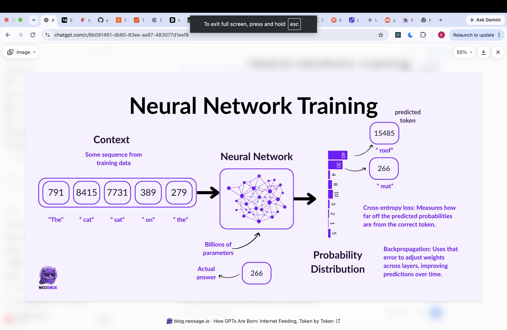

# What is pretraining?
- Pre-training is the process of training LLM model on large amount of data to make model learn the patterns in the language, code etc by predict the next token.

- But how does the model learn from this data??
- This is where next token predicion mechanism comes in the picture.

# How does pretraining works?
- The LLM predicts the next word on the basis of the tokens it has already recieved.
- In pre-training the model repeatedly practices this task using training data.

- for example
- Training sentence
The cat is sitting on the mat

- Training example
Input:
The cat is

- Model prediction:
sitting

Correct target
Expected next token: sitting

- In pretrainig the model predict the next word and compare it with the original result.
- The same transformer architecture is used to predict the next token but all the params are random.
- Which means the initial vector embdding for each token in pretrainin are learned and continuously updated during training.
- If model predicts the wrong next token than the backpropogation takes place and each random values/parameters are tweaked little bit again again until the model predict the correct next Token.
- This process is repeated billion of times on huge amount of data set.
-

- Important: The model is not manually given a rule such as:
- Cats are animals.
- Databases store information.
- JavaScript uses functions.

- Instead, it learns patterns from examples.
- This is the foundation of pretraining.

# What is self supervising learning.
- Self supervising learning is themchainine learning approch in which the model it'self generates the labels and supervsiory singals from raw unlabaeld data. Unlike in supervised learning where data needs to be annatated by humans.

- Like in supervised learning if we want to creaate the data cat detection model than we need to train the model on data which have explicit label like image of a cat -> Label cat etc.

- But in llm model how billion of data sentences can be lebelled manually?
- That's where self supervising learning comes in play.
- The model training data its self have the training target.

- For example 
- Original training text
  I love learning artificial intelligence

- The model receives context
  I love learning artificial

- The training target
  Intelligence
  The next token from the original text

- The model creates its own training targets from the data.
- That's why we call it self-supervised learning.

# 4. What does Pretraining actually teach an LLM?
- Now let's understand what the model gains from this process.
- Suppose we train an LLM using enormous amounts of text,documentation and programming code.

- What patterns can it learn?

1. Language and grammar: How sentences are structured, how words relate and how grammar works.

2. Facts and concepts: Patterns involving history, science, geography, databases and other subjects.

3. Programming patterns : Syntax, functions, algorithms, APIs and common coding approaches.

4. Reasoning patterns: Patterns involving comparisons, explanations, problem-solving and multi-step solutions.

- One important clarification:
- Pretraining doesn't explicitly teach the model to become a good assistant. It teaches the model to predict and generate patterns in its training data.

# Memorization vs Generalization.
- During pretraining, an LLM repeatedly predicts the next token and updates its parameters using backpropagation and an optimizer.

- Memorization - The model learns or retains specific information from its training examples.
- Generalization - The model learns the patterns during training and applied those patterns on the examples the model hasn't encountered suring training.
- That's generalization: applying patterns learned from many examples to a new situation.

- The LLM can do both.

- This is why AI engineers care about:
- Training data: examples used to train the model.
- Validation data: examples used to monitor model performance during training.
- Test data: held-out examples used to evaluate performance.